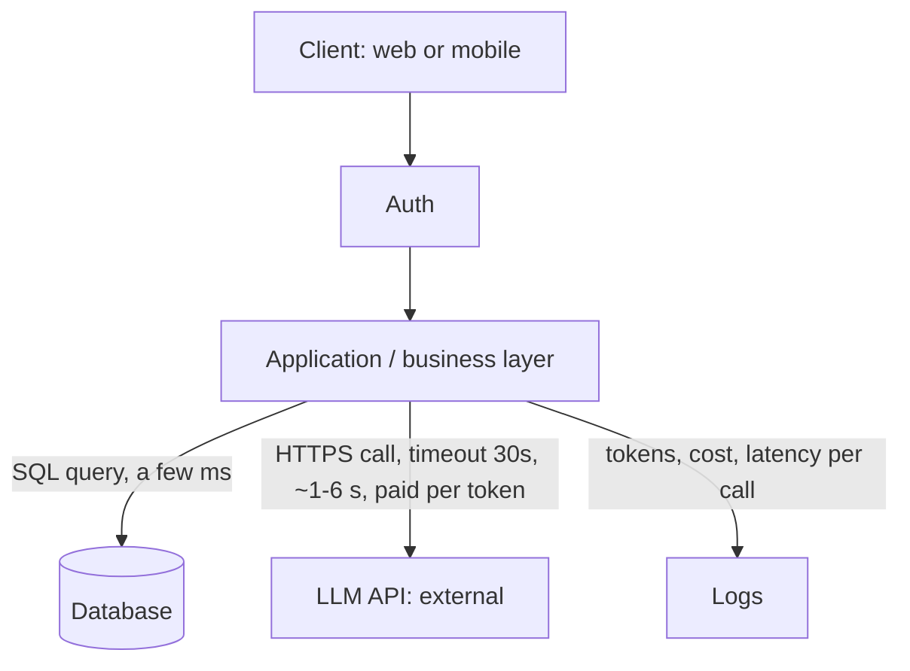
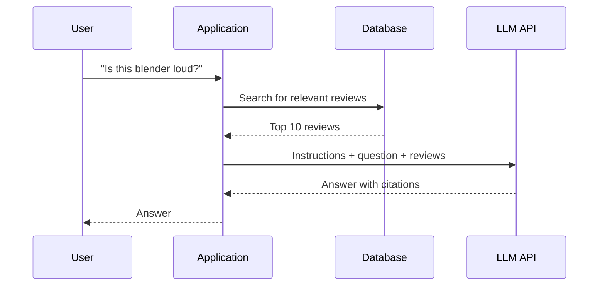

# ai-engineering-lab

Daily exercises and notes from my 90-day AI engineering roadmap (Oct 2026 – Jan 2027). Each day has its code and notes in `days/dayXX/`. The four portfolio projects live in their own repos:

| Project | Repo | Domain |
|---|---|---|
| ShelfSense: product Q&A over catalog data and reviews | [retail-product-qa-rag](https://github.com/Arunpondugula/retail-product-qa-rag) | Retail |
| ShiftWise: LLM agent plus OR-Tools solver for compliant scheduling | [workforce-scheduling-agent](https://github.com/Arunpondugula/workforce-scheduling-agent) | Retail |
| ComplaintOps: multi-agent bank complaint triage | [complaint-triage-multiagent](https://github.com/Arunpondugula/complaint-triage-multiagent) | Finance |
| LedgerGuard: real-time fraud scoring with LLM investigation | [realtime-fraud-detection-platform](https://github.com/Arunpondugula/realtime-fraud-detection-platform) | Finance + retail |

## How to run

Requires Python 3.12 and [uv](https://docs.astral.sh/uv/).

```bash
uv sync                      # install the exact versions from uv.lock
cp .env.example .env         # PowerShell: Copy-Item .env.example .env
# open .env and add your API key
uv run days/day01/hello_llm.py
```

## Where an LLM sits in a system

The LLM is an external API that the application calls, the same way it would call any third-party service. It is much slower than a database call, costs money on every call, and can return a different answer each time, so every call is wrapped with timeouts, error handling and logging.



| Component | What it does | What breaks without it |
|---|---|---|
| Client | Sends the user's question | No way to use the system |
| Auth | Checks who the caller is | Anyone can use it and run up the bill |
| Application | Coordinates every step, builds the prompt, owns timeouts and retries | Nothing ties the pieces together |
| Database | Stores and searches the real data | The LLM has nothing true to answer from |
| LLM API | Understands the question and writes a readable answer | Users get raw rows instead of an answer |
| Logs | Records tokens, cost and latency for every call | No idea what the system costs or why it is slow |

### Request flow (retrieval-augmented generation)



**Why add an LLM when a database is faster:** the LLM understands plain-language questions and turns a lot of raw data into one readable answer, which a database can't do. The trade-off is that it is slower, costs money per call, and can be wrong.

## Repo layout

```
days/dayXX/     code and notes for each day
notes/          notes that span many days (cheat sheets, interview prep)
src/            shared code reused across days
```

## Progress

| Day | Date | Topic | Proof |
|---|---|---|---|
| 1 | 2026-10-14 | Setup, first LLM call with token, latency and cost logging, system map | [notes](days/day01/notes.md) · [code](days/day01/hello_llm.py) |